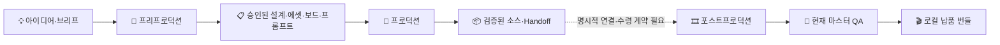

<div align="center">

# 🎬 Video Skills

### 아이디어에서 제작 소스, 검증된 마스터까지

**프리프로덕션 · 프로덕션 · 포스트프로덕션을 단계별 계약으로 연결하는 영상 제작 스킬 모음**

[](video-postproduction-skills/pyproject.toml)
[](#-제작-파이프라인)
[](video-postproduction-skills/qa/implementation/review02-full-checkpoint.txt)
[](video-postproduction-skills/docs/reviews/postproduction-implementation-final-review-03.md)

[🚀 시작하기](#-시작하기) · [🧩 패키지](#-패키지-구성) · [✅ 검증](#-검증과-지원-범위) · [📚 문서](#-문서-지도)

</div>

---

## ✨ 무엇을 위한 저장소인가요?

영상 제작을 하나의 긴 프롬프트가 아니라 **역할·산출물·승인·검수·인계가 구분된 작업**으로 다룹니다.

- 📝 **기획을 제작 가능한 입력으로** — 시놉시스, 캐릭터·에셋, 콘티, 스토리보드, 영상 프롬프트.
- 🎥 **생성과 채택을 분리** — 참조 의존성, 실제 결과 관측, 테이크 검수, 재개 가능한 작업 이력.
- 🎞️ **후반작업은 실제 도구로** — FilmCraft·EffectCraft·SoundCraft의 서로 다른 CLI를 사용한 편집·합성·믹싱.
- 🔎 **증거가 있어야 완료** — 소스 핀, 범위·시간 계약, 현재 QA, 필수 납품물과 체크섬.
- 🛡️ **자동화에도 승인 경계** — 설치·비용·전송·권리·최종본 채택은 별도 조건으로 확인.

## 🔄 제작 파이프라인



> [!IMPORTANT]
> 세 패키지가 존재한다는 사실과 **전체 자동 연결 완료**는 다릅니다. 포스트프로덕션 패키지의 로컬 구현은 완료됐지만, 상위 오케스트레이터의 포스트 연결은 별도 인계·수령 계약을 확인해야 합니다. 소스 준비나 러프 연결본을 최종 납품으로 표시하지 않습니다.

## 🧩 패키지 구성

| 단계 | 주요 역할 | 진입점 | 범위 |
| :--- | :--- | :--- | :--- |
| 📝 **Preproduction** | 감독 + 개발·에셋·콘티·프롬프트·운영 부서 | [프리프로덕션 README](video-preproduction-skills/README.md) · [감독](video-preproduction-skills/production-director/SKILL.md) | 설계·스토리보드·제작 입력 |
| 🎥 **Production** | 총괄·배치·참조/연속성·QA·인계, 5개 역할 | [프로덕션 README](video-production-skills/README.md) · [총괄](video-production-skills/production-supervisor/SKILL.md) | 소스 생성 작업의 계약·관측·채택·Handoff |
| 🎞️ **Postproduction** | 총괄·편집·모션·컬러·음향·자막·피니싱·QA, 8개 역할 | [포스트프로덕션 README](video-postproduction-skills/README.md) · [총괄](video-postproduction-skills/postproduction-supervisor/SKILL.md) | 실제 native 후반작업·현재 QA·로컬 납품 |

공용 에이전트 진입점은 **[SKILL.md](SKILL.md)** 입니다. 기존 부서 지침과 자동 호출 금지 설정을 임의로 바꾸지 않습니다.

## 🚀 시작하기

### 1. 저장소 받기

```bash
git clone https://github.com/DeclanJeon/video-skills.git
cd video-skills
```

### 2. 필요한 단계의 운영 문서 읽기

- **기획·콘티·프롬프트** → [프리프로덕션 문서](video-preproduction-skills/README.md)
- **프로덕션 작업 관리** → [프로덕션 운영](video-production-skills/docs/operations.md)
- **편집·합성·믹싱·납품** → [포스트프로덕션 운영](video-postproduction-skills/docs/operations.md)

### 3. 기존 환경에서 로컬 CLI 확인

아래는 **이미 필요한 Python 의존성이 준비된 환경**에서 실행하는 도움말·구조 검사입니다. 의존성을 설치하거나 미디어 작업을 자동 실행하지 않습니다.

```bash
# Production: Python 3.12 이상
(cd video-production-skills && python3 scripts/production.py --help)
(cd video-production-skills && python3 scripts/check_package.py --json)

# Postproduction: Python 3.14 이상
(cd video-postproduction-skills && python3 scripts/postproduction.py --help)
(cd video-postproduction-skills && python3 scripts/check_package.py --json)
```

> [!NOTE]
> Git clone은 에이전트의 전역 스킬 등록, Craft 설치, 공급자 계정 연결 또는 유료 실행 승인이 아닙니다. 실제 native 시험에는 지원되는 기존 CLI·FFmpeg·격리 도구·폰트 등 운영 문서의 환경이 필요합니다. 다른 컴퓨터에서 동일 결과를 보장하지 않습니다.

## ✅ 검증과 지원 범위

포스트프로덕션의 **기록된 최종 로컬 검증**은 다음과 같습니다. 배지는 실시간 GitHub Actions 결과가 아닙니다.

| 확인 항목 | 기록된 결과 |
| :--- | :--- |
| 🧪 전체 회귀 | **438 passed**, 실패·오류·건너뜀 0 |
| 🧷 타입 검사 | basedpyright 오류·경고 0 |
| 🧩 패키지 구조 | 8개 역할 및 14개 공개 입력 스키마 |
| 🗂️ 수락 사례 추적 | 52개 ID → 실제 실행된 PASS 사례 334개 |
| 🔒 보호 입력 | 기존 216개 파일 해시 유지 |
| 👁️ 독립 검수 | **APPROVED**, 미해결 Critical / Important / Minor 0 |

근거: [전체 테스트 기록](video-postproduction-skills/qa/implementation/review02-full-checkpoint.txt) · [독립 검수](video-postproduction-skills/docs/reviews/postproduction-implementation-final-review-03.md) · [완료 기록](video-postproduction-skills/docs/reviews/implementation-closeout-03.md)

> [!WARNING]
> 위 결과는 **로컬 기술 구현과 synthetic fixture 범위**입니다. 실제 인간의 전구간 시청·청취, 법적 권리나 동의 발급자 진위, 신규 벤더 설치, 모든 OS·코덱·폰트·플러그인 호환성, 임의 9:16 변환·MOGRT 재현·색보정을 인증하지 않습니다. 공급자 생성·업로드·게시 역시 별도 승인과 실제 실행 검증이 필요합니다. Ruff lint 통과는 주장하지 않습니다.

## 🛡️ 안전한 실행 원칙

1. **점검 → 재사용 → 질문 → 동의 → 설치**: 목표 승인이나 무료·프로젝트 로컬이라는 이유로 새 프로그램을 설치하지 않습니다.
2. **Unknown은 재실행 신호가 아닙니다**: 실제 작업·프로세스·산출물을 대조한 뒤 복구합니다.
3. **현재성을 다시 확인합니다**: 과거 QA가 바뀐 소스·새 인코딩·다른 분기에 자동 승계되지 않습니다.
4. **원본과 다른 작업자를 보존합니다**: 소유하지 않은 파일·프로세스·잠금을 삭제하거나 강제로 가져오지 않습니다.
5. **단계를 섞지 않습니다**: 계획·예약·렌더·관측·기술 검수·최종 납품은 서로 다른 상태입니다.

## 📚 문서 지도

| 문서 | 내용 |
| :--- | :--- |
| [공용 진입점](SKILL.md) | 요청 접수·부서 배정·완료 계약 |
| [단계·인계 계약](references/phase-contract.md) | 프리/프로의 경계와 필수 전달 항목 |
| [포스트 연결 슬롯](references/postproduction-slot.md) | 기존 연결 전 체크포인트와 필요한 수령 계약 |
| [오케스트레이터 설계](docs/design.md) | 공용 계층의 설계와 책임 |
| [프로덕션 입력 예제](video-production-skills/examples/README.md) | 로컬 계약 예제·미승인 입력 구분 |
| [포스트 입력 예제](video-postproduction-skills/examples/README.md) | 편집·프로파일·설치 권한 예제 |
| [포스트 수락 사례](video-postproduction-skills/docs/acceptance-map.json) | 실제 테스트 연결과 행별 미검증 범위 |
| [공개 저장소 범위](docs/publication-scope.md) | 게시 제외 항목·기존 내부 Git 이력 보존 |
| [미디어 자료 목록](free_commercial_media_resources_50.csv) | 외부 자료 조사 목록. 개별 서비스의 최신 이용 조건은 별도 확인 |

## 📌 공개 범위와 권리

이 저장소는 소스·스킬 문서·스키마·테스트와 선별된 검증 기록을 공개합니다. 비밀정보, 로컬 캐시·작업 추적 폴더, 외부 절대경로 심볼릭 링크, 원문 레퍼런스 자료와 비공개 작업 아카이브는 포함하지 않습니다.

**배포 라이선스는 아직 지정하지 않았습니다.** 공개 저장소라는 이유만으로 외부 자료·폰트·템플릿·벤더 프로그램의 사용·재배포 권한이 부여되는 것은 아닙니다.

---

<div align="center">

🎬 **Design deliberately. Produce with evidence. Finish with verification.**

</div>
