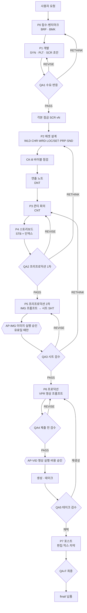

# 01 — 파이프라인·게이트·감독 운영 규약

- 문서 ID: `DES-01` · 상태: `draft-r3`
- 정본 범위: 단계(Phase) 순서, 게이트 판정, 콜시트/납품 패킷, 승인 분리, 루프·재개 규칙. 크루 상세는 [02](02-crew-roster.md), ID는 [03](03-artifact-index.md).

## 1. 전체 흐름



## 2. 단계표 (감독의 유일한 라우팅 표)

감독은 "지금 어느 단계인가"만 판정하면 편성이 정해진다. 단일 산출물 요청은 §6 직행 표를 쓴다.

| 단계 | 목적 | 편성 (리드 → 참여) | 입력 | 산출물 (ID) | 종료 조건 |
|---|---|---|---|---|---|
| **P0 접수·벤치마크** | 요청 해석, 비교 가능한 성공 사례 선정과 구조 해부 | `production-director` → `concept-benchmark` | 사용자 요청, 자료 | `BRF` 브리프, `BMK` 벤치마크 해부, `BOR` 차용 원장 | 목적·대상·플랫폼·길이·톤 확정(추론 포함), 벤치마크 ≥3건 또는 `unknown` 사유 |
| **P1 개발** | 이야기 설계와 각본 초안 | `story-writer` | BRF, BMK, BOR | `SYN` 시놉시스, `PLT` 플롯/비트, `SCR` 각본(대사 `Dnnn` 포함) | 비트 전부가 씬에 배정, 러닝타임 추정 = 목표 ±10% **또는** 초과 사유와 보정안이 납품 `assumptions`에 기록(판단은 QA1 R7과 P3 AD 시간표) |
| **QA1** | 수요·반응 검수 | `audience-reaction-qa` | SCR 초안, BMK, BOR | `QAR-1` 반응 검수 보고 | PASS 또는 2회차 종료 |
| **P2 에셋 설계** | 각본에 등장하는 모든 것의 정본(바이블) | `world-designer` → `character-designer` → (`costume-designer` ∥ `production-designer`) → `sound-designer` | 잠긴 SCR, 요청 소스 범위 | `WLD`, `CHR`(페르소나 포함), `WRD`, `LOC`/`SET`/`ENV`/`PRP`, `SND`(`VOC`/`AMB`/`SFX`/`MUS`와 소스 탐색 상태) | CK-B 및 큐 기능/용도/required·무음 근거와 설계/확보 상태가 구별됨 |
| **연출 노트** | 장면별 목표·서브텍스트·톤·블로킹 콘셉트·카메라 철학 | `production-director` | 잠긴 SCR, 바이블 | `DNT` | 모든 씬에 노트 5항목 |
| **P3 콘티 회의** | 씬·컷·타임라인과 부서별 레이어 | `assistant-director`(진행) → `performance-director` → `cinematographer` → `lighting-director` → `sound-designer` → `vfx-supervisor` → `film-editor` | SCR, DNT, 바이블 전체 | `CNT` 콘티(컷 표 + 부서 레이어) | 컷 합계 = 러닝타임, 모든 `D`가 컷에 배정, 미해결 충돌 0 |
| **P4 스토리보드** | 콘티를 패널로 시각화 계획 + 인덱스 시트 | `storyboard-artist` | CNT, 바이블 | `STB` 스토리보드(패널 + 인덱스 행) | `index_lint` 통과 |
| **QA2** | 프리프로덕션 1차 완료 검수 | `production-qa` (+ 필요 부서 자문) | 모든 P0–P4 산출물 | `QAR-2` | PASS 또는 2회차 종료 |
| **P5 프리프로덕션 2차** | 스토리보드 시트 이미지 | `image-prompt-engineer` → (실행) → `storyboard-artist` 시트 조립 | STB, 바이블 | `IMG` 프롬프트, 에셋 기준 이미지 `REF`, 시트 `SHT` | 모든 패널에 이미지 또는 `blocked` 사유 |
| **QA3** | 시트 검수 (정체성·구도·가독성) | `production-qa` | SHT, STB, 바이블 | `QAR-3` | PASS 또는 2회차 종료 |
| **P6 프로덕션** | 타임라인별 영상 프롬프트 | `video-prompt-engineer` | SHT, STB, 전 바이블, 선택 모델 | `GEN` 생성 작업 묶음, `VPR` 프롬프트 + 사이드카 | `prompt_lint` 통과 |
| **QA4** | 제출 전 검수 | `production-qa` | VPR, 사이드카, STB, 실제 generation_input 오디오의 현재 핀·권리·청취·모드 근거 | `QAR-4` | 해당 제출 PASS; 별도 소스 포함 납품 완료는 §2.1 대조 |
| **생성** | 실제 영상 생성 | `production-director`가 공급자 어댑터 호출 | VPR, REF, AP-VID 승인 | `TAK` 테이크 파일 | 모든 GEN에 테이크 ≥1 |
| **QA5** | 테이크 검수·채택 | `production-qa` (+ `performance-director`, `cinematographer` 자문) | TAK, STB, VPR | `QAR-5`, 채택 구간 | 모든 컷에 채택 구간 |
| **P7 포스트** | 편집·믹스·자막·색 | 별도 포스트프로덕션 실행자; sound-designer는 SND/소스 인계 | 채택 구간, SND, CNT, 실제 소스·권리·큐시트 | `EDL`, 믹스, 자막, 출력본 | 실제 포스트 연결·수령과 출력/검수 근거; 프리 소스 납품만으로 완료 아님 |
| **QA-F** | 최종 재생 검수 | `production-qa` | 출력본 | `QAR-F` | PASS 후 사용자 승인 |

**CK-B(바이블 점검)** 는 게이트가 아닌 자동 점검이다. 감독은 각본의 고유 대상(화자·장소·소품·의상 변화)을 목록화한 후 [인덱스 검사 규약](../../production-ledger/references/ledger-schema.md#단계별-인덱스-검사)에 따라 `index_lint --stage bible`을 호출한다. 미배정 항목은 해당 부서에 재배정한다. 자동 검사는 목록 자체의 누락을 판단하지 않는다.

### 2.1 사운드 소스의 단계별 준비

[DES-11](11-sound-sourcing-integration.md)의 표가 사운드 단계/증빙 연결 정본이다. P2에서 설계와 탐색을 배정하고 P3에서 실제/추정 길이·사용 구간을 합의한다. QA2 설계 PASS를 파일 확보 PASS로 읽지 않는다. P5/QA3는 무관한 post_only 소스 미확보와 독립적으로 진행한다. P6/QA4는 해당 generation_input만 현재 파일·개별 권리·최종 청취·모델 입력/실행 승인으로 차단/허용한다. post_only는 공급자 참조로 자동 전송하지 않는다.

소스 확보가 포함된 요청 종료점에서는 required인 모든 큐의 파일/해시·기술 검사·최종 청취·권리/크레딧·수령자 전달 조건을 제작 QA에 확인시킨다. 범위에 맞는 기존 QAR-2/QAR-4와 DLV에 설계 완료/소스 확보 완료·partial/blocked를 구분해 남긴다. 텍스트-only와 의도된 무음은 해당 소스 의무가 없다는 근거를 남긴다. 새 gate ID나 별도 원장은 만들지 않는다.

## 3. 게이트 규약

### 3.1 판정 3종

| 판정 | 의미 | 다음 행동 |
|---|---|---|
| `PASS` | 차단 결함 없음. 비차단 메모는 기록 | 다음 단계 |
| `REVISE` | 해당 단계 안에서 고칠 수 있는 결함 | 수정 지시(ID 색인)를 담당 크루에 배정 → 영향 범위만 재검 |
| `RETHINK` | 상위 단계의 결정이 원인 | 표의 되돌림 단계로 이동, 영향받는 하위 산출물 전부 `stale` |

### 3.2 회차 상한과 잔여 위험

- 게이트마다 **최대 2회**. 1회차는 전수, 2회차는 수정 지시와 그 영향 범위(`impact set`, [03 §5](03-artifact-index.md#5-변경-전파와-stale))만 검사.
- 2회차 후 남은 결함은 `residual_risk`로 기록하고 진행한다. 예외: 권리·초상·음성 동의·안전 위반, `prompt_lint`의 차단 규칙 위반, 그리고 해당 사운드를 실제 사용하는 제출/확보 포함 납품의 필수 파일·청취·권리/전달 근거 미충족은 진행 불가. 해당 소스의 준비를 통과시킬 수 없다는 뜻이며 독립적인 시각·텍스트 작업은 진행한다.
- QA1에서 2회 연속 `RETHINK`이면 감독은 가장 높은 점수의 변형으로 진행하고 사용자에게 **보고**한다(대기하지 않음). 사용자가 "QA1에서 보여줘"라고 했으면 대기.

### 3.3 수정 지시 형식 (모든 QA 공통)

```yaml
- fix_id: QAR-1.F03
  severity: blocking | major | minor
  target: SCR@v1#S02.D004        # 고칠 대상의 ID
  owner: story-writer            # 배정 크루
  finding: "훅 대사가 6초에 나와 첫 3초에 약속이 없다"
  evidence: [BMK-02#hook, QAR-1.panel.P2]   # 근거 ID, 관측/가설 라벨 포함
  instruction: "S01 첫 컷에 D004의 갈등 약속을 앞당겨 2초 안에 제시"
  acceptance: "0–3초 구간에 갈등 대상과 질문이 모두 보인다/들린다"
```

## 4. 콜시트와 납품 패킷

감독 ↔ 크루 인계는 두 형식뿐이다. 크루는 콜시트에 없는 단계를 스스로 시작하지 않는다.

**단일 기록자 범위.** 크루는 콜시트가 지정한 **자기 산출물 파일만** 쓴다. `ledger.json`(등록·버전·stale·승인·판정)과 `.history`는 감독이 `production-ledger` 절차로만 쓴다. 납품 패킷의 `path`는 등록 요청이지 등록 완료가 아니다.

### 4.1 콜시트 (`CALL`, 감독 → 크루)

```yaml
call_id: CALL-P3-07
project: PRJ-laundromat-standoff
phase: P3
crew: cinematographer
assignment: "CNT@v1 의 C01–C04 카메라 레이어 작성"
inputs:                        # 버전 핀 필수
  - SCR@v2
  - CHR-01@v1
  - CHR-02@v1
  - LOC-01@v1
  - CNT@v1#layers.ad,performance
locked: ["180도 축: CHR-01 좌, CHR-02 우", "총 34.0초"]
exclusions: ["환형 이동", "슬로모션"]
craft_refs: [cinematographer/references/lens-and-size.md]
stop_at: "레이어 반환"         # 이 콜시트의 끝
authority: []                  # 실행·비용 권한 (비어 있으면 없음)
```

### 4.2 납품 패킷 (`DLV`, 크루 → 감독)

```yaml
dlv_for: CALL-P3-07
artifacts:
  - id: CNT@v2
    path: <project>/03_conti/CNT.md
    changed: ["layers.camera"]
consumed: [SCR@v2, CHR-01@v1, CHR-02@v1, LOC-01@v1]
assumptions: ["C02 OTS 전경 비율 1/5 은 SCR 지문에서 추론"]
conflicts:                     # 다른 부서와 충돌하면 감독 판정 요청
  - with: lighting-director
    item: "C04 ECU 에서 역광 유지 시 눈 반사광 부족"
checks: ["컷별 렌즈·사이즈 빈칸 0"]
missing_inputs: []             # 있으면 ID와 필요한 부서
self_verdict: complete | partial
```

## 5. 승인 분리 (v1 정책 승계)

| 승인 | 여는 것 | 묻는 시점 | 자동 통과 조건 |
|---|---|---|---|
| 기획 수락 | 없음(입력일 뿐) | 묻지 않음 | 항상 진행, 산출물 `proposed` |
| `AP-IMG` | 유료/외부 이미지 생성 | P5 실행 직전 | 무료 경로(예: 로컬 Codex Imagen)는 승인 불필요, 단 참조 이미지 외부 전송은 사용자 권한 범위 안 |
| `AP-VID` | 유료 영상 생성 | QA4 PASS 직후 | 사용자가 실행 범위를 승인한 경우만. 비용 한도는 사용자가 지정했을 때만 기록·적용한다. 한도 없음은 실행 승인이 아니다. |
| 권리·초상·음성 동의 | 실존 인물·브랜드·음성 클론 | 해당 에셋 사용 전 | 없음 |
| 게시 | 외부 게시 | QA-F 후 | 없음 |

게이트 PASS는 승인이 아니고, 승인은 게이트 PASS를 대신하지 않는다. QA5의 재생성은 `AP-VID`에서 승인된 모델·예산 범위 안에서만 자동 진행하고, 예산을 넘으면 `대기`한다.

## 6. 직행 표 (단일 산출물 요청)

사용자가 전체 제작이 아니라 하나만 원하면 감독은 파이프라인을 돌리지 않고 해당 크루를 단독 배정한다. 상위 산출물이 없으면 크루가 가정을 명시하고 진행한다.

| 요청 예 | 크루 | 비고 |
|---|---|---|
| "이 대본 반응 어떨지 봐줘" | `audience-reaction-qa` | BMK 없으면 벤치마크 레인 `unknown` |
| "이 주제로 레퍼런스 찾아서 구조 뽑아줘" | `concept-benchmark` | |
| "시놉시스/각본 써줘" | `story-writer` | |
| "캐릭터 시트/페르소나" | `character-designer` | |
| "의상 설정" / "세계관" / "장소·소품" / "사운드 바이블" | 해당 디자인 부서 | 사운드 설계와 실제 소스 확보 범위를 구별 |
| "이 씬 음원 찾아서 파일까지 준비" | `sound-designer` → 범위별 제작 QA | DES-11; 현재 프로젝트/권한 범위 안 실제 검색·청취·권리 확인·필요 파일 확보 |
| "이 씬 카메라 설계" / "조명 플랜" / "표정 연출" | `cinematographer` / `lighting-director` / `performance-director` | |
| "콘티 짜줘" | 콘티 회의 경량 모드 | 여러 부서이므로 감독 진행 |
| "스토리보드 이미지 프롬프트" | `image-prompt-engineer` | |
| "이 콘티로 영상 프롬프트" | `video-prompt-engineer` | 입력이 인덱스 없으면 경량 인덱스 자동 생성 |
| "이 프롬프트 검수" | `production-qa` QA4 모드 | |

## 7. 운영 모드

| 모드 | 조건 | 차이 |
|---|---|---|
| 표준 | 기본 | 위 단계표 전체 |
| 경량 | 러닝타임 ≤60초 **그리고** 씬 ≤3 | 콘티 회의를 1라운드 합본으로: 감독이 한 콜시트에 여러 부서 레이어를 묶어 배정, 부서별 "해당 없음" 허용 |
| 재개 | 기존 프로젝트 | 원장(`ledger.json`)과 `.history`를 먼저 읽고 마지막 미완 단계부터. 파일 존재만으로 단계를 추론하지 않는다 |
| 협업 | 사용자가 "같이 정하자" | 각 단계 종료마다 요약 보고 후 사용자 입력 대기 |

## 8. 감독의 응답 마감 규칙

완성 영상 목표의 응답은 마지막 한 줄을 다음 둘 중 하나로 닫는다(v1 계약 승계, 표현 단순화).

- `다음: <다음 단계> — 자동 진행`
- `대기: <승인 게이트 또는 막는 사실> — 필요: <정확한 승인 또는 사실>`

`대기` 사유는 AP-IMG(유료일 때)·AP-VID·권리 동의·게시·사용자 지정 정지·주제/목적 부재와, 요청한 산출물에 필수인 소스 파일·청취/권리 증거·도구 등 실제 차단 사실이다. 필요한 사실/권한과 정확한 재개점을 쓰고 영향받는 작업만 보류한다. QA 통과를 위한 형식적 확인 질문과 기획 수락은 대기 사유가 아니며 독립 작업은 계속한다.

## 9. 실행 메커니즘

하네스(Pi·Codex·Claude Code)에는 스킬이 스킬을 함수처럼 호출하는 기능이 없다. "콜시트 발행"은 다음 둘 중 하나로 실현한다.

| 방식 | 조건 | 절차 |
|---|---|---|
| **인라인**(기본) | 항상 가능 | 감독이 해당 크루 `SKILL.md`를 그때 읽고(미리 읽지 않음) 콜시트 범위만 수행한 뒤 DLV를 작성하고 감독 역할로 돌아온다. 작업 중에는 `acting_as: <crew>`를 표기한다. |
| **서브에이전트** | 서브에이전트 도구가 있고 사용자가 위임을 허용한 경우 | 콜시트와 입력 파일 경로만 넘긴다. 우선 적용 대상: QA1–QA5 게이트(독립성), P2 병렬 부서(costume ∥ production-designer). 결과는 DLV로만 받는다. |

**새로 읽기 규칙(인라인 QA).** 인라인으로 QA를 수행할 때는 작성 과정의 추론을 근거로 쓰지 않고, 디스크의 산출물 파일을 다시 열어 그 내용만으로 판정한다. QAR 머리에 `reviewer_mode: inline | subagent`를 기록하고, 인라인이면 "독립 검수 아님"을 잔여 위험에 남긴다.
