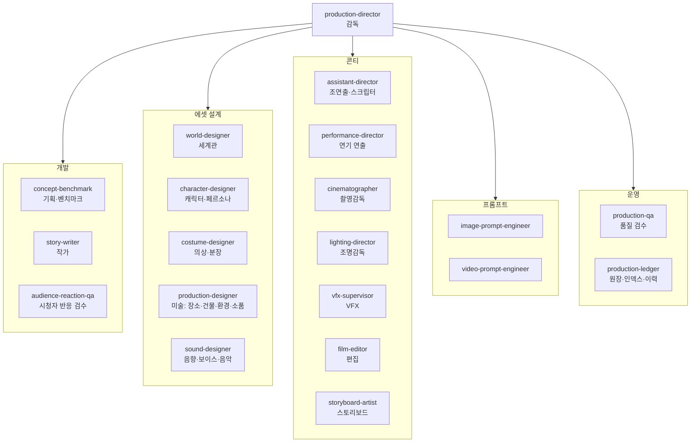

# 02 — 크루 명부 (스킬 = 팀원)

- 문서 ID: `DES-02` · 상태: `draft-r2`
- 정본 범위: 20개 스킬의 직함·책임·소유 산출물·입출력·경계. 단계 순서는 [01](01-pipeline-and-gates.md), 산출물 필드는 [03](03-artifact-index.md).

## 1. 조직도



도구와 공급자 어댑터는 팀원이 아니라 **장비**다([08](08-v1-migration.md)). 장비는 두 종류다.

| 종류 | 예 | 누가 쓰나 |
|---|---|---|
| **조사 장비** (무료·읽기 전용) | `searching-social-media`, `flucto-media-research`(검색·자막 읽기), `camera-motion-reference-analysis` | 콜시트 범위 안에서 크루가 직접 |
| **실행 장비** (생성·유료·외부 전송·로컬 렌더) | `higgsfield-generate`, `fal-video-production`, `codex-imagen`, `suno-music`, ElevenLabs/Typecast/Fish Audio MCP, `blender-previsualization` | 감독/오케스트레이터의 승인된 배정만. 스톡 사운드 검색·청취·무료 파일 확보는 DES-11과 콜시트 범위에서 sound-designer가 수행; 새 비용/계정/약관/전송은 별도 승인 |

## 2. 공통 스킬 골격

모든 크루 `SKILL.md`는 아래 순서를 지킨다. 크루마다 다른 것은 §3의 표 내용뿐이다.

```markdown
---
name: <crew-name>
description: <직함>. production-director가 <단계>에 배정하거나, 사용자가 <단독 산출물>만 요청할 때 사용. (≤40단어)
---
# <직함>
## 역할                — 한 문단. 소유 산출물과 하지 않는 일.
## 입력                — 콜시트 inputs 중 필수/선택. 없을 때 가정 규칙.
## 절차                — 번호 단계. 각 단계는 완료 기준으로 끝난다.
## 산출물              — 템플릿 링크(assets/<ID>-template.md)와 필수 필드.
## 다른 부서와의 경계  — 자문 받는 부서, 넘기는 부서, 충돌 시 감독 판정 요청.
## 자체 점검           — 납품 전 체크리스트(검사 가능 항목만).
## 납품                — DLV 패킷 형식 링크.
```

- 단독 호출(직행)이면 프로젝트·원장 없이 채팅으로 산출물만 반환하고 ID는 임시(`tmp:`) 접두사.
- 크루는 다른 크루를 직접 호출하지 않는다. 필요한 입력은 납품 패킷의 `missing_inputs`로 감독에 요청한다.

## 3. 크루 상세

### 감독

| 스킬 | `production-director` (감독/오케스트레이터) |
|---|---|
| 단계 | 전 단계 |
| 소유 | `ledger.json`의 상태 전이, 콜시트, 충돌 판정 기록(`RUL`), 응답 마감 줄, **연출 노트 `DNT`** |
| 연출 노트 | P3 전에 씬마다 5항목: 장면 목표(관객이 느낄 것), 서브텍스트, 톤·연기 양식("무대극이 아니라 …"), 블로킹 콘셉트(누가 어디서 무엇을 막는가), 카메라 철학 한 줄. 콘티 회의 전 부서의 공통 입력이며 영상 프롬프트 B2의 정본 |
| 하는 일 | 요청 해석 → 단계 판정 → 콜시트 발행 → 납품 수령·`index_lint` 실행 → 게이트 소집 → 판정에 따라 진행/되돌림 → 승인 게이트에서만 대기 → 공급자 어댑터 호출 |
| 하지 않는 일 | 각본·디자인·프롬프트를 감독 자격으로 작성(인라인 실행은 `acting_as: <crew>`로 크루 절차를 따름, [01 §9](01-pipeline-and-gates.md#9-실행-메커니즘)), 승인 추론 |
| 충돌 판정 우선순위 | 사용자 제약 > 이야기 기능(SCR의 비트 목적) > 연속성(바이블) > 실행 가능성(모델 한계) > 부서 취향 |

### Phase A — 개발

| 스킬 | 직함 | 소유 산출물 | 핵심 절차 | 경계 |
|---|---|---|---|---|
| `concept-benchmark` | 기획·벤치마크 PD | `BRF` 브리프, `BMK-nn` 벤치마크 해부, `BOR` 차용 원장 | ① 목적·대상·플랫폼·길이·톤 확정(추론은 `inferred` + 이유) ② 같은 플랫폼·형식·길이의 성공 사례 3–5건 수집(관측 지표·날짜) ③ 사례마다 구조 해부: 훅 시점, 비트 간격, 감정 곡선, 반전 위치, 길이, 컷 밀도, 댓글 반응 패턴 ④ 공통 패턴 → 차용/변주/고유 원장 | 지표는 관측만, 없으면 `unknown`. 수집 도구는 v1 `flucto-media-research`/`searching-social-media`를 장비로 사용 |
| `story-writer` | 작가 | `SYN` 시놉시스, `PLT` 플롯(비트시트), `SCR` 각본(씬헤딩·지문·대사 `Dnnn`) | ① BOR의 차용 구조 위에 로그라인 ② 비트(`B`)별 목적·감정·정보 ③ 씬 배정과 추정 길이 ④ 각본 초안 — 대사는 화자·전달(속도·강세·쉼)과 함께 ⑤ QA1 수정 지시 반영 | 연기 세부(표정 AU)는 쓰지 않음 — 지문은 관찰 가능한 행동까지 |
| `audience-reaction-qa` | 시청자 반응 검수자 | `QAR-1` | [04](04-qa1-audience-reaction.md) 절차 전체 | 작가와 독립. 수정안을 직접 쓰지 않고 지시만 |

### Phase B — 에셋 설계 (design departments)

| 스킬 | 직함 | 소유 산출물 | 핵심 절차 | 경계 |
|---|---|---|---|---|
| `world-designer` | 세계관·고증 | `WLD` 세계관 바이블: 시대·지역·사회 규칙·기술 수준·금지 요소(예: 현대 물품)·색/재질 팔레트 근거 | ① SCR에서 세계 규칙이 걸린 대사·지문 추출 ② 시대/장르 고증 항목 표 ③ 화면 금지 목록(anachronism) ④ LOOK 후보 | 사실 주장은 출처 표시. 허구 세계는 내부 규칙 일관성만 |
| `character-designer` | 캐릭터·페르소나 | `CHR-nn` 캐릭터 바이블: 정체성 앵커(나이·체형·얼굴 표지·헤어), 페르소나(동기·결핍·결정 규칙·MBTI/에니어그램 선택), 말투, 목소리 정체성 서술, 기본 표정 습관 | ① 각본의 화자/등장인물 목록화 ② 정체성 앵커는 **프롬프트에 그대로 옮겨 쓸 수 있는 문장**으로 확정 ③ 실존 인물 모방 금지 문구 ④ 7뷰 레퍼런스 시트용 서술 | 의상은 `costume-designer`, 실제 음성 캐스팅은 `sound-designer` |
| `costume-designer` | 의상·헤어·분장 | `WRD-nn` 의상 바이블: 캐릭터별 의상 상태(`WRD-01a`, `01b`…), 소재·색·마모, 헤어·분장, 상태 변화가 일어나는 씬 | ① CHR × 씬 매트릭스로 의상 상태 배정 ② 상태별 고정 서술 문장 ③ 변화 사유(시간 경과·사건) | 세계관의 시대·팔레트 준수 |
| `production-designer` | 미술감독 | `LOC-nn` 장소(배경 레이어 `#layers` 포함), `SET-nn` 세트/건물, `ENV-nn` 환경(시간대·날씨·계절), `PRP-nn` 소품/도구 | ① 각본 장소·건물·소품 추출 ② 장소 4뷰 서술(정면/역방향/좌/우)과 공간 배치도(`#plan`, 텍스트 평면도) ③ 소품 상태와 소유(누가 언제 쥐는가) ④ 배경 레이어 `#layers`(전경/중경/원경, 심도별 흐림 정도 기준) | 조명 방향은 `lighting-director`와 합의, 자연광 원천(창·문)은 여기서 위치 확정 |
| `sound-designer` | 음향감독 | `SND`, `VOC/AMB/SFX/MUS`, 사운드 레이어, APR, 검색/소스 원장·실제 파일·권리/청취 증빙·크레딧 | [DES-11](11-sound-sourcing-integration.md): P2 설계·자료처 순회 시작 → P3 큐/용도/사용 구간·실측 여부 합의 → 소스 확보 범위의 후보 청취·개별 권리·필요 파일 확보 → P6 소유 APR 갱신·QA/인계 근거. 설계와 소스 확보 완료를 분리 | 새 TTS/음악 생성은 승인된 실행자에게 요청; 원장 등록은 감독. 실제 배치·편집·믹싱/마스터는 별도 포스트. 크루가 타 부서 APR/VPR을 임의 수정하지 않음 |

### Phase C — 콘티 (production meeting)

| 스킬 | 직함 | 소유 레이어/산출물 | 핵심 절차 | 경계 |
|---|---|---|---|---|
| `assistant-director` | 조연출·스크립터 | `CNT` 골격: 씬→컷→(테이크) 분해, 컷 시간표(start/end), 대사(`D`) 배정, 연속성 원장(`CTY`: 위치·소품 소유·의상 상태·시선/축) | ① 각본을 컷으로 분해 ② 대사 길이 추정(언어별 말속도 표, [07 §3](07-video-prompt-spec.md#3-타임라인-블록-규칙)) ③ 컷 시간표 합계 검증 ④ 회의 진행: 부서 순서 관리, 충돌 목록 유지 | 컷 의도는 작가·감독의 것, AD는 구조와 시간 |
| `performance-director` | 연기 연출 | `CNT.layers.performance`: DNT 블로킹 콘셉트의 상세 동선(시작 위치·이동·멈춤), 컷/하위구간별 감정 목표, 관찰 가능한 얼굴·호흡·시선·몸 변화, FACS AU 보조, 대사 전달(속도·강세·쉼·떨림), 청자 반응 | ① 감정 곡선을 하위 구간으로 쪼갬(예: 3.7–6.5s) ② 구간마다 시작→정점→정착 ③ 표정은 "부위+움직임" 서술, AU는 괄호 보조 ④ 과장 금지 목록 | 카메라 사이즈가 표정 가독성을 막으면 촬영과 협의 |
| `cinematographer` | 촬영감독 | `CNT.layers.camera`: 사이즈, 앵글, 렌즈(mm), 심도, 구도 비율, 무빙/고정과 이유, 축(180도)·시선, 전환 방식 | ① 축과 화면 방향 고정 ② 컷마다 렌즈·사이즈·무빙 ③ 반복 셋업 재사용(`CAM-nn`) ④ 금지 무빙 목록 | 실제 3D 검증이 필요하면 v1 `blender-previsualization`을 장비로 요청 |
| `lighting-director` | 조명감독 | `LGT-nn` 조명 셋업, `LOOK-nn` 룩(색·대비·그레인), `CNT.layers.lighting` | ① 장소의 자연광 원천 기반 키/필/백 방향 ② 셋업 재사용 ③ 컷 간 매칭 ④ 상업 광고 조명 같은 금지 룩 | 원천 위치는 `production-designer` 정본 |
| `vfx-supervisor` | VFX | `VFX-nn`, `CNT.layers.vfx` | ① 필요/불필요 판정(불필요면 이유 한 줄로 끝) ② 효과 기능·구간·레이어 ③ AI 생성 시 위험(손·텍스트·물리) | 대부분 대사극은 "N/A + 이유" |
| `film-editor` | 편집감독 | `CNT.layers.edit`: 컷 포인트, 전환(하드컷/디졸브), 리듬, 오버랩 대사(J/L컷); P7 `EDL` | ① 컷 길이 리듬 검토 ② 대사 오버랩 결정(예: 대사가 다음 컷으로 이어짐) ③ 생성 묶음(GEN) 경계 제안 | P7에서 실제 편집 |
| `storyboard-artist` | 스토리보드 작가 | `STB` 스토리보드: 패널(`P`) + **인덱스 행**(컷마다 모든 참조 ID); P5 `SHT` 시트 조립 | ① CNT 컷을 패널로(컷당 1–3패널: 시작/정점/끝) ② 패널 구도 서술 ③ 인덱스 행 작성 ④ `index_lint` 통과 ⑤ P5에서 생성 이미지를 시트로 조립 | 이미지 프롬프트는 `image-prompt-engineer`가 작성 |

### Phase D/E — 프롬프트

| 스킬 | 직함 | 소유 산출물 | 핵심 절차 | 경계 |
|---|---|---|---|---|
| `image-prompt-engineer` | 이미지 프롬프트 엔지니어 | `IMG-*` 이미지 프롬프트: 에셋 기준 이미지(캐릭터 7뷰, 의상, 장소 4뷰, 소품, LOOK 프레임)와 패널 프롬프트 + 사이드카 | [06](06-image-prompt-spec.md) | 모델 선택·실행은 감독 |
| `video-prompt-engineer` | 영상 프롬프트 엔지니어 | `GEN-nn` 생성 묶음 계획, `VPR-nn` 영상 프롬프트(8블록) + 사이드카 `VPR-nn.map.json` | [07](07-video-prompt-spec.md) | 컷·대사·표정 비트를 바꾸지 않는다. 바꿔야 하면 감독에 `RETHINK` 요청 |

### 운영

| 스킬 | 직함 | 소유 | 핵심 절차 | 경계 |
|---|---|---|---|---|
| `production-qa` | 품질 검수 | `QAR-2`~`QAR-F` | 게이트별 체크리스트([03 §6](03-artifact-index.md#6-게이트별-qa-체크리스트)) 실행, 기계 검사(`index_lint`, `prompt_lint`, `timeline_check`) + 판단 검사, 수정 지시 색인 | 직접 고치지 않음. 2회 상한 |
| `production-ledger` | 원장·이력 | `ledger.json`, `.history/`, 산출물 레지스트리, 검사 스크립트 | 프로젝트 루트 초기화, 아티팩트 등록(경로·버전·해시), stale 전파, 이력 기록 | 쓰기는 감독의 요청으로만(단일 기록자) |

## 4. RACI 요약 (R=작성, A=판정, C=자문, I=통보)

| 산출물 | R | A | C |
|---|---|---|---|
| BRF·BMK·BOR | concept-benchmark | director | — |
| SYN·PLT·SCR | story-writer | director (QA1 결과 근거) | concept-benchmark |
| QAR-1 | audience-reaction-qa | director | — |
| WLD | world-designer | director | story-writer |
| CHR | character-designer | director | world, sound |
| WRD | costume-designer | director | character, world |
| LOC/SET/ENV/PRP | production-designer | director | world, lighting |
| SND·소스/큐시트·권리/청취 증빙 | sound-designer | director (scope별 제작 QA 근거) | character, production-designer, assistant-director |
| DNT | director | director | story-writer, performance-director |
| CNT | assistant-director (골격) + 각 부서 (레이어) | director | 전 부서 |
| APR (separate 오디오) | sound-designer | director (QA4) | performance-director |
| STB | storyboard-artist | director (QA2) | cinematographer |
| IMG·SHT | image-prompt-engineer / storyboard-artist | director (QA3) | character, costume, production-designer |
| GEN·VPR | video-prompt-engineer | director (QA4) | performance, cinematographer, sound |
| QAR-2..F | production-qa | director | 관련 부서 |
