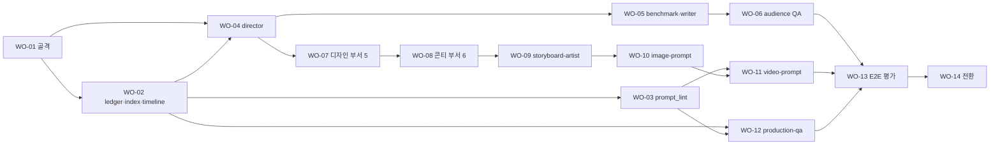

# contents-production-skills v2 — 작업지시서 색인

> **For agentic workers:** REQUIRED SUB-SKILL: superpowers:subagent-driven-development (권장) 또는 superpowers:executing-plans로 WO 단위 실행. 단계는 체크박스(`- [ ]`)로 추적한다.

**Goal:** 감독 1 + 크루 19 스킬과 검사 스크립트 3종으로 "기획 → QA1 → 에셋 → 콘티 → 스토리보드 → QA2 → 시트 → QA3 → 영상 프롬프트 → QA4 → 생성 → QA5 → 포스트" 파이프라인을 구현한다.

**Architecture:** 스킬은 SKILL.md + references/ + assets/(템플릿) 문서 패키지. 기계 검사는 `scripts/` 아래 Python 표준 라이브러리 CLI. 프로젝트 상태는 `ledger.json` 단일 파일, 기록자는 감독 하나.

**Tech Stack:** Markdown SKILL 포맷(Pi/Codex/Claude Code 공통), Python 3.10+ 표준 라이브러리, pytest.

**Spec:** [docs/design/00-overview.md](../design/00-overview.md) 및 DES-01–09, [EX-01b 골격](../examples/ref-prompt-01/masked-skeleton.md), [EX-02 합성 픽스처](../examples/synthetic-laundromat-34s/fixture.md)

## Global Constraints

- 패키지 루트: `contents-production-skills-v2/` · 버전 `0.1.0`부터 시작 · 정본 목록 `manifest.json`
- 스킬 이름(정확히): `production-director`, `concept-benchmark`, `story-writer`, `audience-reaction-qa`, `world-designer`, `character-designer`, `costume-designer`, `production-designer`, `sound-designer`, `assistant-director`, `performance-director`, `cinematographer`, `lighting-director`, `vfx-supervisor`, `film-editor`, `storyboard-artist`, `image-prompt-engineer`, `video-prompt-engineer`, `production-qa`, `production-ledger` (20개)
- 크루 description: ≤40 영어 단어 또는 ≤120 한글 글자, "production-director가 배정" 문구 포함. 감독 description ≤80단어.
- 모든 SKILL.md는 [DES-02 §2 공통 골격](../design/02-crew-roster.md#2-공통-스킬-골격)의 7개 헤딩을 순서대로 가진다.
- ID 문법은 [DES-03 §2](../design/03-artifact-index.md#2-id-문법)만 사용. 새 접두사는 DES-03에 먼저 추가.
- 스크립트: 외부 의존성 없음, 종료 코드 0=통과/1=차단 결함/2=사용 오류, `--json` 출력 지원.
- v1 파일 수정 금지. v1 지식 이관 시 references 머리에 `source: v1 <경로>@2.66`.
- 프로젝트 산출물은 스킬 저장소 밖(`Media_Studio/<project_id>/`)에만 쓴다.
- 레퍼런스 프롬프트는 구조·패턴만 쓴다. 스킬·references·템플릿·테스트 픽스처·평가 케이스에 레퍼런스의 인물·대사·장소·전제를 쓰지 않고 EX-02 또는 새 원작 합성 장면을 쓴다(DES-09 §5, `SK07`/`REF_LEAK`).

## Review Focus

- **대사가 컷 경계를 넘는 경우(L컷)**: timeline_check와 index_lint가 같은 대사를 "중복 배정"으로 오판하지 않아야 한다 → WO-02 테스트 `test_lcut_dialogue_not_duplicate`.
- **한국어·중국어·일본어 혼용 대사의 말속도 계산**: 언어 감지 실패 시 차단이 아니라 `UNVERIFIED` 경고 → WO-02 `test_mixed_language_rate_unverified`.
- **단독(직행) 호출**: 프로젝트·원장 없이 크루를 부를 때 ID가 `tmp:`이고 파일을 쓰지 않아야 한다 → WO-04 평가 케이스 E-04.
- **바이블 갱신 후 stale 전파**: CHR 앵커만 바뀌었을 때 해당 행만 stale → WO-02 `test_anchor_scoped_stale`.
- **레퍼런스 내용 누출**: 구현자가 "예시를 그대로" 옮기다 레퍼런스 대사·인물을 references에 넣는 경우 → WO-01 `test_reference_leak_SK07`
- **다중 GEN 고정 블록 해시**: 공백·줄바꿈 차이로 해시가 달라지는 오탐 → 정규화 후 해시, WO-03 `test_fixed_block_hash_normalized`.

## 실행 순서와 의존

| WO | 제목 | 산출 | 크기 |
|---|---|---|---|
| [WO-01](WO-01-package-skeleton.md) | 패키지 골격·manifest·스킬 검사기 | 20개 스킬 디렉터리 골격, `check_skills.py` | S |
| [WO-02](WO-02-ledger-index-timeline.md) | 원장·ID 파서·index_lint·timeline_check | `production-ledger`, 스크립트 2종 + 테스트 | L |
| [WO-03](WO-03-prompt-lint.md) | prompt_lint (영상 L1–L20, 이미지 I1–I7) | 스크립트 + 테스트 | M |
| [WO-04](WO-04-production-director.md) | 감독 스킬 | `production-director` | M |
| [WO-05](WO-05-development-crew.md) | 기획·작가 | `concept-benchmark`, `story-writer` | M |
| [WO-06](WO-06-audience-reaction-qa.md) | 1차 QA | `audience-reaction-qa` | M |
| [WO-07](WO-07-design-departments.md) | 에셋 설계 5부서 | world/character/costume/production/sound | L |
| [WO-08](WO-08-conti-departments.md) | 콘티 6부서 | AD/performance/cinematographer/lighting/vfx/editor | L |
| [WO-09](WO-09-storyboard-artist.md) | 스토리보드·시트 조립 | `storyboard-artist`, `assemble_sheet.py` | M |
| [WO-10](WO-10-image-prompt-engineer.md) | 이미지 프롬프트 | `image-prompt-engineer` | M |
| [WO-11](WO-11-video-prompt-engineer.md) | 영상 프롬프트 | `video-prompt-engineer` | L |
| [WO-12](WO-12-production-qa.md) | 게이트 QA | `production-qa` | M |
| [WO-13](WO-13-e2e-evaluation.md) | 종단 평가 | 평가 시나리오 3종·결과 | L |
| [WO-14](WO-14-cutover.md) | 전환·설치 | 설치 문서, 워크플로 지시 변경안 | S |

## 공통 완료 정의 (모든 WO)

- [ ] 해당 SKILL.md가 `check_skills.py` 통과
- [ ] 산출물 템플릿(`assets/*-template.md`)이 DES-03 필드와 일치
- [ ] WO에 적힌 평가 케이스를 실제로 실행하고 결과를 `qa/wo-XX/`에 저장 (시뮬레이션 금지, 미실행은 `UNVERIFIED`로 기록)
- [ ] `CHANGELOG.md`에 한 줄
